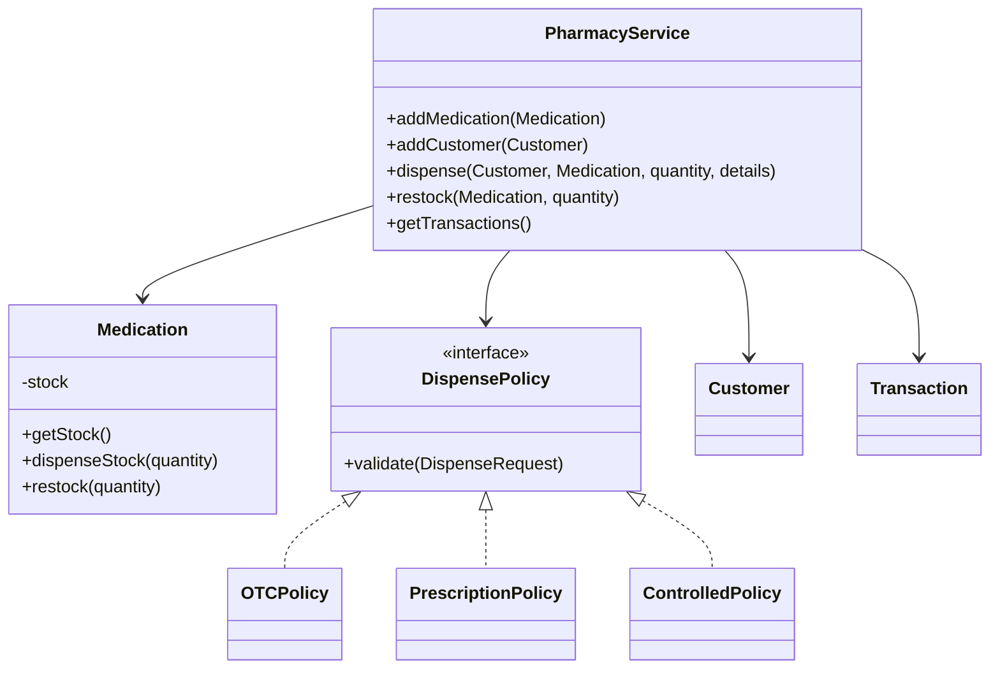

# Akosua's Pharmacy: System Diagnosis and Proposed Design

## 1. Diagnosis of the Starter Program

The starter program combines the application's entry point, data models, dispensing operations, inventory management, transaction recording, and reporting in a single source file.

Although this approach may work for a small demonstration, it creates significant maintenance and reliability challenges as the pharmacy system grows. Business rules are spread across mutable objects and conditional statements rather than being enforced consistently at the points where data changes.

The following table identifies the main problems, their underlying causes, and their potential business impact.

| Priority | Root cause | Business risk |
|---|---|---|
| **Critical** | Dispensing reduces stock without first verifying that sufficient quantities are available. The sample attempts to dispense 100 units of amoxicillin when only 39 remain. | Inventory can become negative, making stock reports unreliable and potentially leading staff to make unsafe dispensing decisions. |
| **High** | Inventory fields are publicly accessible, and restocking accepts unrestricted quantities. | Other parts of the application can modify stock directly or introduce invalid quantities, bypassing the intended business rules. |
| **High** | Medicine categories and customer types are represented by unrestricted strings, while dispensing rules are handled through conditional statements inside `Pharmacy`. | Typographical errors and new medicine categories can cause incorrect behaviour. Introducing controlled medicines would require modifying existing conditional logic, increasing the risk of breaking established dispensing rules. |
| **High** | The starter program has no automated tests. | Changes to stock management, pricing, or prescription validation cannot be checked consistently, increasing the likelihood of regressions. |
| **Medium** | Dispensing validation does not adequately check positive quantities, prescription information, or whether the customer and medicine belong to the pharmacy. | Invalid dispensing requests may be accepted and incorrectly recorded as successful transactions. |
| **Medium** | Transaction history, customer history, and pharmacy collections expose mutable internal data. | External code can modify or remove records without using authorised business operations, weakening data consistency and transaction traceability. |
| **Medium** | Business logic, reporting, data models, and application entry points are tightly coupled. | Changes to one part of the application can affect unrelated functionality, making maintenance, testing, and future development more difficult. |
| **Low** | Monetary values and transaction totals use `double`. | Floating-point precision can produce inaccurate currency calculations as the application handles more transactions. |
### Most Critical Finding: Inventory Integrity

The negative-stock defect represents the most serious business risk.

Inventory figures are used to determine whether a medicine is available for dispensing. If the system allows stock to become negative or otherwise inaccurate, staff may rely on incorrect information when making dispensing decisions.

For a pharmacy, this is more than a reporting problem: it can affect the reliability of medicine availability information and create potential patient-safety concerns.

The system should therefore enforce stock validation before every dispensing operation and prevent invalid inventory changes.

## 2. Proposed System Design

The proposed redesign separates the application into smaller components, each with a clearly defined responsibility.

The objective is to improve encapsulation, enforce business rules consistently, support future expansion, and make the application easier to test and maintain.

### Proposed Class Structure

### Responsibilities of the Main Components

**1. PharmacyService**

Acts as the central coordinator for pharmacy operations.

Its responsibilities include:

- Registering medicines and customers.

- Coordinating dispensing and restocking operations.

- Ensuring validation occurs before stock is changed.

- Recording successful transactions.

- Providing access to transaction history without exposing the internal collection for modification.

**2. Medication**

Owns and protects its inventory information.

Its responsibilities include:

- Keeping stock fields private.

- Providing controlled methods for dispensing and restocking.

- Rejecting zero or negative quantities.

- Preventing stock from falling below zero.

This ensures that inventory rules are enforced within the object responsible for managing stock.

**3. DispensePolicy Interface**

Defines a common contract for validating medicine dispensing requirements.

Different implementations can enforce different rules without placing every condition inside one central dispensing method.

The planned implementations are:

- `OTCPolicy`: validates over-the-counter dispensing requirements.

- `PrescriptionPolicy`: validates prescription-related requirements.

- `ControlledPolicy`: enforces additional requirements for controlled medicines.

This design uses interface-based polymorphism to make the system easier to extend.

**4. Customer**

Represents a pharmacy customer and protects customer-related information and dispensing history.

**5. Transaction**

Represents a completed pharmacy transaction, retaining relevant information about the customer, medicine, quantity, and dispensing details.

Transaction records should not be created for unsuccessful dispensing attempts.

## 3. Extensibility: Supporting Controlled Medicines

One important requirement of the redesign is the ability to introduce controlled medicines without disrupting existing dispensing functionality.

In the original design, dispensing behaviour is determined by conditional statements inside the `Pharmacy` class. Adding a new medicine category would require changing that central logic.

The proposed design replaces this approach with separate policy implementations.

For example, introducing controlled medicines would involve implementing `ControlledPolicy` through the `DispensePolicy` interface.

This policy would enforce the additional requirements for controlled substances, such as:

- Validating the prescriber's information.

- Checking any additional required controlled-substance details.

- Ensuring the required information is retained in the dispense record.

The existing OTC and prescription policies would remain separate and would not need to be rewritten simply because a new category was introduced.

This follows the Open/Closed Principle: the system should be open to extension while minimising modifications to existing, working components.

## 4. Design and Implementation Progress

The proposed architecture represents the planned direction of the redesign. It should not be interpreted as a claim that the complete system has already been implemented.

Since the initial design work, a first inventory-safety improvement has been introduced in `PharmacyTracker.java`.

The implemented changes include:

- Making the stock field private.

- Introducing guarded dispensing and restocking methods.

- Rejecting invalid stock quantities.

- Preventing dispensing operations that would result in negative inventory.

- Updating the sample scenario so that an attempted overstock dispensing request is rejected.

This is an important first step because it addresses the most critical defect identified in the original program.

However, the improvement does not yet resolve all the architectural problems identified in the diagnosis. The broader redesign, including policy-based dispensing, improved transaction handling, stronger validation, and automated testing, remains part of the proposed implementation work.

## 5. Conclusion

The starter pharmacy application has several weaknesses relating to inventory integrity, encapsulation, validation, maintainability, and extensibility.

The most urgent concern is the possibility of dispensing more medicine than is available, which can result in unreliable stock records and potentially unsafe business decisions.

The proposed redesign addresses these weaknesses through encapsulation, interface-based polymorphism, separation of responsibilities, and stronger validation.

The initial stock-safety improvement provides a foundation for the wider redesign. The remaining work will focus on introducing dispensing policies, protecting transaction records, improving validation, and adding automated tests.

The overall goal is to develop a pharmacy management system that is reliable, maintainable, testable, and capable of supporting new medicine categories without unnecessarily disrupting existing functionality.
